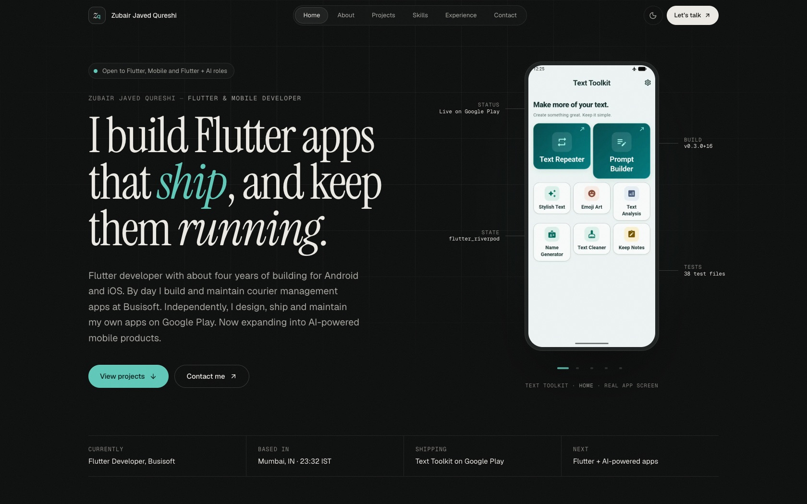
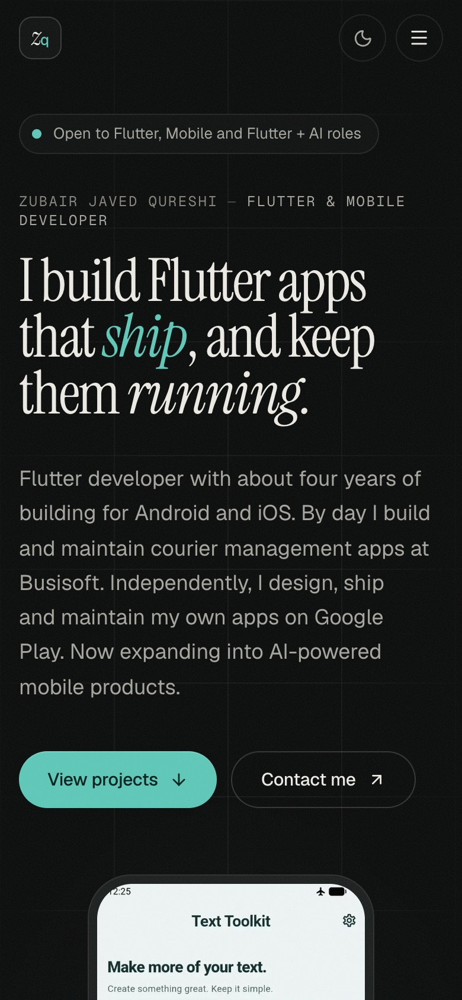
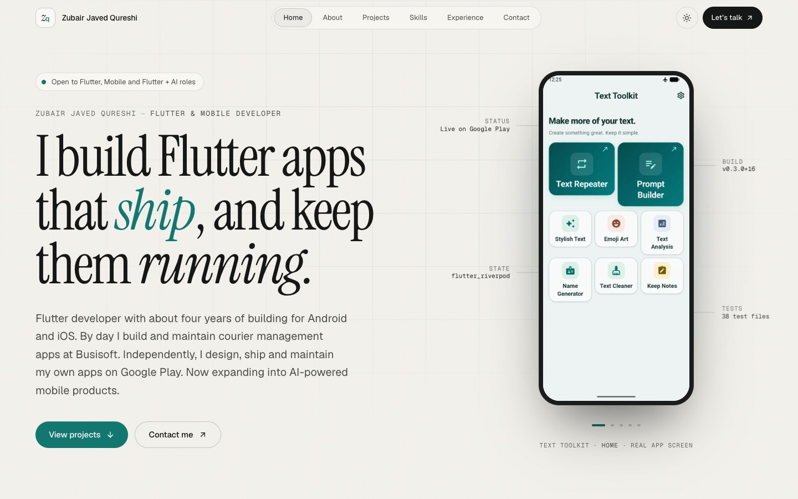

# Zubair Javed Qureshi: Portfolio

This is the personal portfolio of **Zubair Javed Qureshi**, a Flutter and mobile application developer based in Mumbai who is expanding into AI-powered apps.



<p align="center">
  
  &nbsp;
  
</p>

## Highlights

- **Editorial dark design with a full light theme.** Typography is Instrument Serif with Geist and Geist Mono. The accent is Text Toolkit's brand teal.
- **Real evidence only.** Every app screenshot is a genuine capture, every statistic comes from the actual codebases, and every project carries an honest status label (*Live*, *Closed testing*, *In development*).
- **Annotated hero device.** The hero cycles through real Text Toolkit screens, with call-outs that state verifiable facts.
- **Mostly static.** The page is prerendered, so most of it ships no client JavaScript. Client components are limited to the header, theme toggle, hero device, screenshot rails, local time and scroll reveals.
- **Accessible.** It uses semantic landmarks, a skip link, visible focus, keyboard-operable galleries and menu, and honours `prefers-reduced-motion`.
- **SEO.** Metadata API, canonical URL, Open Graph and Twitter cards, a generated OG image, JSON-LD (`Person`, `MobileApplication`, `WebSite`), `sitemap.xml`, `robots.txt` and a web manifest.

## Tech stack

| Area | Choice |
|------|--------|
| Framework | Next.js 16 (App Router, Turbopack, Cache Components) |
| Language | TypeScript 5 |
| Styling | Tailwind CSS 4 (CSS-variable design tokens) |
| Motion | Motion for React 14 (`LazyMotion` + `domAnimation`) |
| Icons | Lucide React, plus inline SVG brand marks |
| Fonts | `next/font/google`: Instrument Serif, Geist, Geist Mono |

The only runtime dependencies are `next`, `react`, `react-dom`, `motion` and `lucide-react`.

## Getting started

```bash
npm install
npm run dev          # http://localhost:3000
npm run check        # typecheck + lint + production build
```

Requires Node.js 20.9 or later.

## Project structure

```
src/
  app/            layout, page, metadata routes (sitemap, robots, manifest, OG image, icons)
  sections/       page sections: Header, Hero, About, Projects, Skills, Experience, Contact, Footer
    projects/     FeaturedProject, ProjectSpread, LabProject, ScreenshotRail, …
  components/     reusable UI: ButtonLink, StatusBadge, PhoneFrame, Reveal, ThemeToggle, …
  data/           ← all content lives here
  lib/            small utilities
  assets/fonts/   OFL fonts used for the generated OG image
public/projects/  genuine app screenshots and icons
```

## Updating content

All copy and data live in `src/data/`:

| File | What it controls |
|------|------------------|
| `profile.ts` | Name, intro, links, availability, **`email`** and **`resumeUrl`** (both `null` by default, so their UI is hidden) |
| `projects.ts` | Projects, status badges, specs, features, engineering notes, screenshots, build log |
| `skills.ts` | Skill groups, with "evidence" tags linking each skill to where it was used |
| `experience.ts` | Roles and education |

**To add a project**, append an object to `projects` in `src/data/projects.ts`:

- Put screenshots in `public/projects/<slug>/` and list them in `screenshots`. A project with screenshots gets a full spread.
- If `screenshots` is empty, the project appears under "On the workbench" with a clearly labelled typographic placeholder.
- Set `featured: true` on exactly one project to make it the flagship spread.

**To add a résumé**, put the PDF in `public/` and set `resumeUrl: "/your-file.pdf"` in `profile.ts`. A Résumé button then appears in the hero.

**To show an email address**, set `email` in `profile.ts`. It appears as the first row in Contact.

## Deployment (Vercel)

No environment variables are required. One is optional:

| Variable | Purpose | Default |
|----------|---------|---------|
| `NEXT_PUBLIC_SITE_URL` | Absolute URL for canonical, OG, sitemap and robots | `https://zubair-javed-portfolio.vercel.app` |

1. Push this repository to GitHub.
2. In Vercel, choose **Add New → Project**, import the repo, keep the detected Next.js defaults, and deploy.
3. If the assigned domain differs from the default above, set `NEXT_PUBLIC_SITE_URL` in **Settings → Environment Variables** and redeploy.

You can also deploy from the CLI: `npx vercel` (preview) and then `npx vercel --prod`.

## Documentation

- [RESEARCH.md](RESEARCH.md): portfolio research and design direction
- [PROJECT_PROGRESS.md](PROJECT_PROGRESS.md): build log and QA results

## Credits

Instrument Serif is licensed under the SIL Open Font License (`src/assets/fonts/OFL.txt`). Geist is by Vercel. App screenshots are © Zubair Javed Qureshi.
